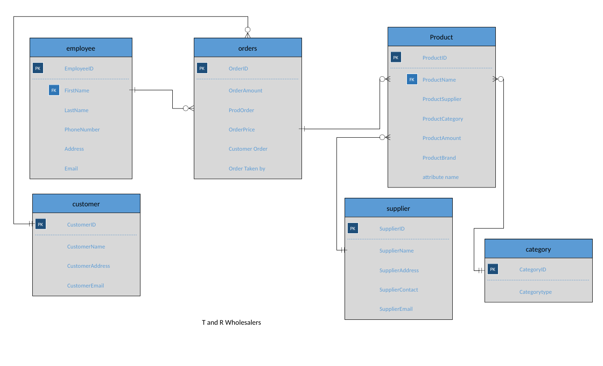

# SQL Database Projects

Relational database design and SQL query work in MySQL / MariaDB.

## T&R Wholesalers — database design (group project, team lead)

A database designed for a small wholesale and retail business that sells consumable goods in bulk to shops, restaurants and event planners. The business kept everything in a single paper diary: no inventory list, and no easy way to see what customers had ordered or when. Our four-person team designed a database to replace it. **I was the team leader.**



**Tables**

| Table | Purpose |
|---|---|
| `category` | Product categories (bottled water, canned foods, baked goods, …) |
| `product` | Each product with its brand, supplier, category, stock level, unit price and size |
| `supplier` | Suppliers and their contact details |
| `customer` | Business customers, their location and email |
| `employee` | Staff who take orders |
| `orders` | Each order: product, quantity, price, customer and the employee who took it |

The design includes primary keys on every table, `UNIQUE` constraints to prevent duplicates (category names, customer names, supplier names) and `AUTO_INCREMENT` IDs.

**Possible improvements:** link `orders` to `product`, `customer` and `employee` by ID with `FOREIGN KEY` constraints instead of storing names, and add an order date.

*Customer and employee records are fictional sample data. Suppliers are real, publicly listed distributors.*

## Marina database — SQL queries

A set of queries against a marina database (marinas, boat slips and boat owners), covering:

- Choosing columns and filtering with `WHERE`, `!=`, `<`, `BETWEEN` and `OR`
- Sorting with `ORDER BY`
- Aggregates with `COUNT(*)` and `SUM()`

`marina-queries/marina.sql` creates and fills the database. `marina-queries/queries.sql` holds the 12 queries, each with a comment explaining what it answers.

## Running

Import a `.sql` file into MySQL or MariaDB, for example with phpMyAdmin (XAMPP) or from the command line:

```bash
mysql -u root -p -e "CREATE DATABASE tr_wholesalers"
mysql -u root -p tr_wholesalers < tr-wholesalers/tr_wholesalers.sql
```
